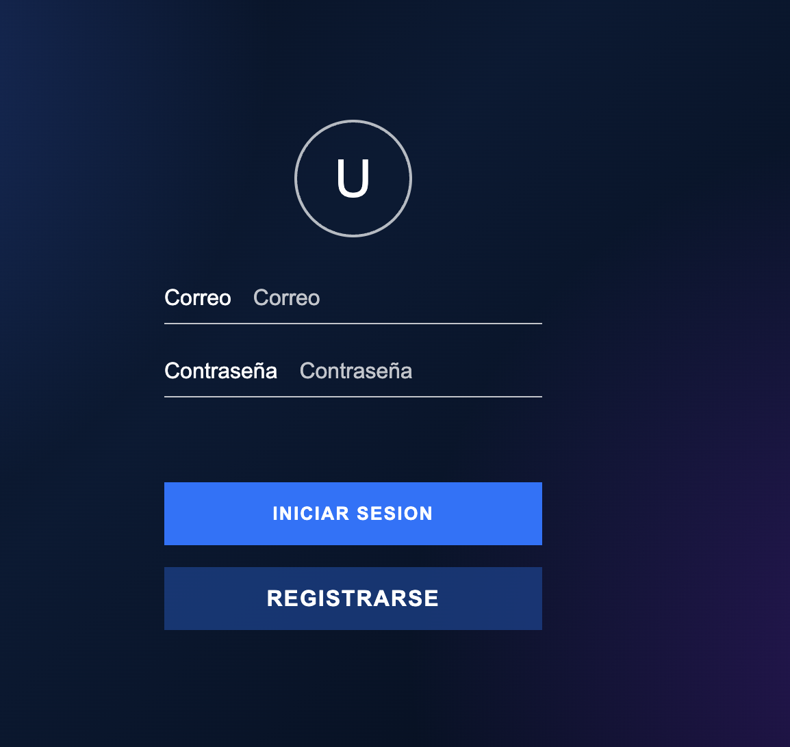
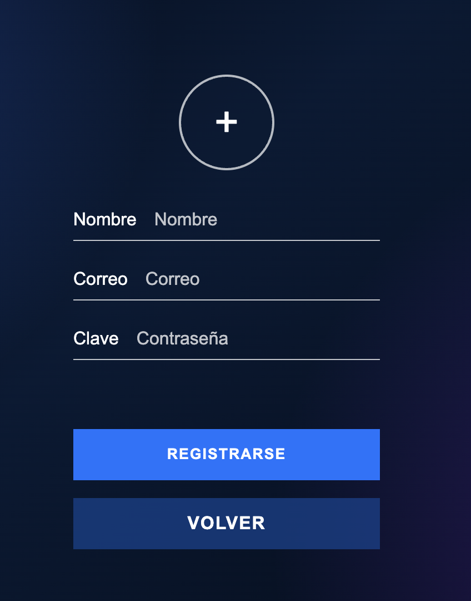
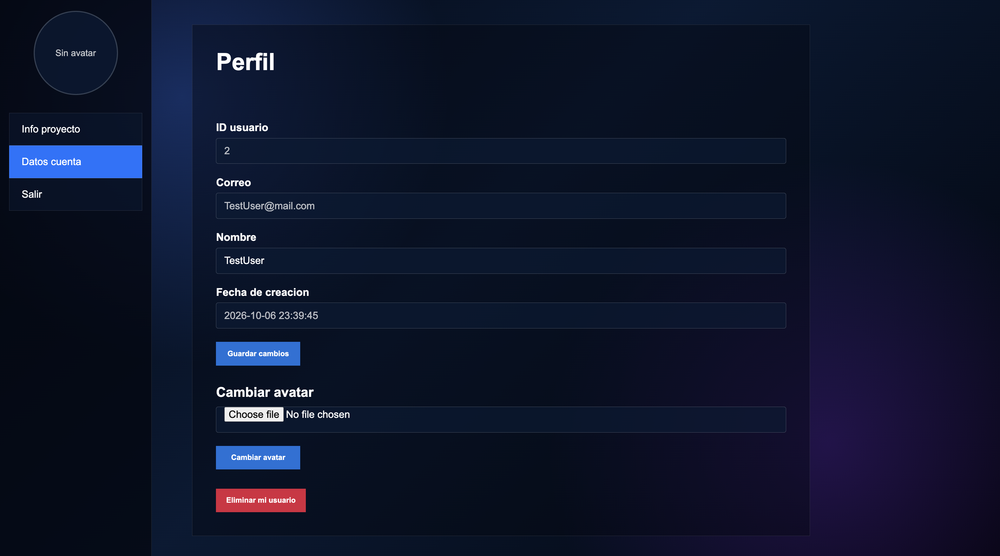
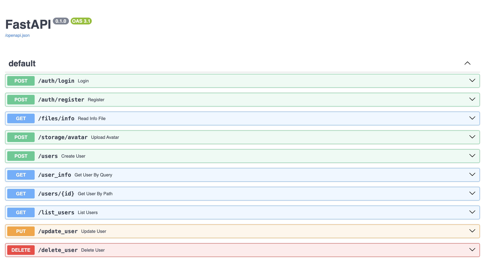

# User Management REST API

English | [Español](README.es.md)

Final project for the Programming module, developed during the first year of the Web Application Development program (Desarrollo de Aplicaciones Web, DAW).

The application combines an HTML, CSS, and JavaScript frontend with a REST API built with FastAPI. It includes authentication through Supabase, local persistence with SQLite, and avatar management with Supabase Storage.

## Features

- Registration and login with Supabase Auth.
- Session validation using Bearer tokens.
- CRUD operations on profiles stored in SQLite.
- Data persistence with SQLite.
- Data access implementations using `sqlite3` and SQLAlchemy.
- Avatar uploads to Supabase Storage through its S3-compatible interface.
- Reading information from a server file.
- Web interface for managing the user profile.

## Screenshots

### Login and registration

<p align="center">
  
  
</p>

### User profile



### API documentation



## Technologies

- Python 3.10+
- FastAPI and Uvicorn
- SQLite and SQLAlchemy
- Supabase Auth and Supabase Storage
- Boto3
- HTML5, CSS3, and JavaScript

## Architecture

The backend is organized into layers to separate responsibilities:

- `controllers`: endpoints and HTTP request handling.
- `services`: application rules and logic.
- `adapters`: access to SQLite, SQLAlchemy, and Supabase Storage.
- `models`: input, response, and domain models.

Through the `UserAdapter` interface, the service layer can use either the direct `sqlite3` implementation or the SQLAlchemy implementation. Switching between them only requires replacing the adapter configured in `UserServiceImpl`, without modifying the controllers or business logic.

```text
.
├── backend
│   ├── adapters
│   │   ├── implementations
│   │   │   ├── supabase_s3_adapter.py
│   │   │   ├── user_no_orm_adapter.py
│   │   │   └── user_orm_adapter.py
│   │   └── interfaces
│   │       ├── storage_adapter.py
│   │       └── user_adapter.py
│   ├── controllers
│   │   ├── auth_controller.py
│   │   ├── file_controller.py
│   │   ├── storage_controller.py
│   │   └── user_controller.py
│   ├── services
│   │   ├── implementations
│   │   │   ├── auth_service_impl.py
│   │   │   ├── storage_service_impl.py
│   │   │   └── user_service_impl.py
│   │   └── interfaces
│   │       ├── auth_service.py
│   │       ├── storage_service.py
│   │       └── user_service.py
│   ├── models
│   ├── data
│   ├── database
│   ├── app.py
│   └── main.py
├── frontend
│   ├── app.js
│   ├── index.html
│   ├── login.html
│   ├── style.css
│   └── users.html
├── tests
│   ├── conftest.py
│   ├── test_auth_service.py
│   ├── test_storage_adapter.py
│   ├── test_user_controller.py
│   ├── test_user_no_orm_adapter.py
│   └── test_user_service.py
├── docs
│   └── images
├── .env.example
├── .gitignore
├── LICENSE
├── README.es.md
├── README.md
├── requirements-dev.txt
└── requirements.txt
```

## Getting started

### 1. Create and activate a virtual environment

```bash
python -m venv .venv
source .venv/bin/activate
```

On Windows:

```powershell
.venv\Scripts\activate
```

### 2. Install dependencies

```bash
python -m pip install -r requirements.txt
```

### 3. Configure Supabase

Copy `.env.example` as `.env` and complete the variables with the details from your own Supabase project:

```bash
cp .env.example .env
```

```dotenv
SUPABASE_URL=
SUPABASE_ANON_KEY=
SUPABASE_S3_ENDPOINT=
SUPABASE_S3_REGION=
SUPABASE_S3_ACCESS_KEY=
SUPABASE_S3_SECRET_KEY=
SUPABASE_S3_BUCKET=
```

The project expects email and password authentication, a public bucket for avatars, and a public `profiles` table associated with Supabase Auth users.

> The `.env` file contains credentials and is excluded from the repository.

### 4. Run the backend

```bash
cd backend
uvicorn main:app --reload
```

The API will be available at `http://127.0.0.1:8000`, with its interactive documentation at `http://127.0.0.1:8000/docs`.

The `backend/database/database.db` database is created automatically when a user endpoint is used for the first time.

### 5. Run the frontend

From the project root, in another terminal:

```bash
python -m http.server 5500 --directory frontend
```

Open `http://127.0.0.1:5500` in your browser.

## Tests

The SQLite adapter tests use a separate temporary database and do not modify the application's data.

Install the development dependencies and run the test suite with:

```bash
python -m pip install -r requirements.txt -r requirements-dev.txt
pytest -q
```

The suite contains 30 tests and checks:

- Table creation and CRUD operations using a temporary SQLite database.
- Independence between records and user listing.
- Service layer validations.
- Authentication and authorization, including `401`, `403`, and `404` status codes.
- Login with Supabase Auth using a mocked response.
- Avatar uploads using a mocked S3 client.

The Supabase and S3 tests do not make Internet requests or require real credentials.

The author selected the test cases based on the behaviors considered necessary to validate. They were implemented with the support of artificial intelligence tools, and the results were reviewed before being added to the project.

## Main endpoints

| Method | Endpoint | Description |
| --- | --- | --- |
| `POST` | `/auth/register` | Registers a user |
| `POST` | `/auth/login` | Logs in and returns a token |
| `POST` | `/users` | Creates a local user |
| `GET` | `/users/{id}` | Retrieves a user |
| `GET` | `/user_info?id={id}` | Retrieves a user through a query parameter |
| `GET` | `/list_users` | Lists user identifiers |
| `PUT` | `/update_user` | Updates the authenticated user's name |
| `DELETE` | `/delete_user?id={id}` | Deletes the authenticated user's public Supabase profile and local record |
| `POST` | `/storage/avatar` | Uploads and updates the avatar |
| `GET` | `/files/info` | Reads the project information |

## Security

- Passwords are managed through Supabase Auth and are not stored in SQLite.
- Credentials are loaded from environment variables.
- Update and delete operations verify that the token belongs to the owner of the user record.
- The email address is considered part of the identity managed by Supabase Auth and is not modified through the local profile.
- The `.env` file, local databases, and temporary files are excluded through `.gitignore`.
- The repository does not contain real users, email addresses, or credentials.

## Development process

The backend, application architecture, and SQLite and Supabase integration were developed by the author.

Artificial intelligence tools supported the implementation of part of the interface and JavaScript code, following the requirements and behavior defined by the author. The result was later reviewed and integrated with the backend.

## License

This project is distributed under the MIT License. See the [LICENSE](LICENSE) file for more information.

## Author

Brooklyn Muñoz Acevedo
